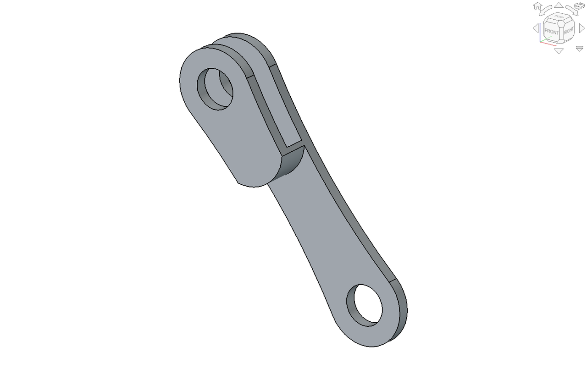

# FLEXOR-inspired active-spine quadruped model

Editable **FreeCAD robot CAD**, coupled spine and compliant leg mechanisms, and **Blender animations** built from the CAD geometry and kinematics.

This independent research reconstruction is inspired by **FLEXOR-F** from Wang et al., [*Unlocking fast robotic locomotor propulsion through dynamic spine-leg synergy*](https://doi.org/10.1126/sciadv.aed5603), *Science Advances* **12**(39), eaed5603 (2026). The paper, supplementary kinematic diagrams, and Movies S1/S2 guide the design. This repository contains our reconstruction and engineering assumptions; it is not the authors' original CAD or a validated reproduction of their experimental performance.

**Latest checkpoint: r15 · 16 October 2026 · Research CAD candidate**

R15 restores fuller shelf-to-motor-mount shoulders in the one-piece lumbar frame and adds smooth support-root transitions, guided by Movie S1. [Matched comparisons and verification](docs/25_sculpted_geometry_refinement_r15.md).

[](animation/previews/r15_spine_leg_coordination.mp4)

This short r15 preview uses preserved prescribed kinematics. The full studio video below remains an r14 result.

## Spine–leg coordination

[](animation/output/spine_leg_coordination_s2_r14.mp4)

The looping GIF shows one complete cycle of the retained r14 design. **Both the spine and legs move.** The full [25-second, 1080p/60-fps video](animation/output/spine_leg_coordination_s2_r14.mp4) includes whole-robot and mechanism close-ups in a Movie S2-inspired studio presentation.

Motion is **illustrative kinematics**: approximately 69° of full hip excursion, separately prescribed 20° knee excursion, independent winding-wheel motion, and prescribed body pitch/translation. It is not a dynamics simulation or a prediction of ground contact, speed, or running performance. Springs regenerate from their anchors; cable graphics show routing, with loaded slack shape unresolved. See [motion assumptions and reproduction](animation/README.md) and [video verification](reports/animation/spine_leg_coordination_s2_r14_qa.json).

## Latest CAD design


| R15 continuous lumbar shoulder | Retained organic A–B rocker |
| :---: | :---: |
|  |  |

The current assembly has **455 physical component instances** and **108 source definitions**. The retained r14 architecture narrows the central frame to a 78.8 mm transverse span, uses a connected lumbar frame, smooth rockers forked only at B, recessed B–C links, and rounded front/rear mounting profiles. Foreleg and hind-leg assemblies retain their distinct layouts. R15 adds four shelf-shoulder pads and twelve concave root blends without moving mounting or joint datums; the other 107 source parts are unchanged.

| Mechanical feature | Implementation |
| --- | --- |
| Spine | Two coupled sagittal outputs driven through one closed linkage/slider mechanism |
| Spine actuation | 2 × DYNAMIXEL **XL330-M077-T**, synchronized redundant drive |
| Leg actuation | 5 × DYNAMIXEL **XC330-M181-T**: four proximal joints and one shared hind-knee winding wheel |
| Coordinates | **7 physical motors, 6 commanded coordinates**, with passive/prescribed knee states represented separately |
| Legs | Four three-segment compliant legs, tension/compression springs, and bilateral hind-leg cable routing |
| CAD-to-animation interface | Stable instance IDs, separate source geometry, explicit local-to-world transforms, and procedural spring/cable geometry |

The animation consumes the verified CAD mechanism and its closure solution. It does not replace the mechanism with independently posed decorative links.

## Open the model

```bash
git clone https://github.com/jianwei-liu93/Active_spine_quadruped_robot_CAD.git
cd Active_spine_quadruped_robot_CAD
```

Open [**cad/flexor_r15_robot.FCStd**](cad/flexor_r15_robot.FCStd) in FreeCAD for the native editable assembly. Use [**exports/step/r15/flexor_r15_robot.step**](exports/step/r15/flexor_r15_robot.step) for CAD exchange. The [r14 checkpoint](cad/flexor_r14_robot.FCStd) and unsuccessful trials are retained for traceability.

The animation files use Blender 5.2.2 LTS. Large `.blend` scenes and render caches are kept local and ignored by Git; tracked meshes, motion samples, configuration and scripts support regeneration. See [the animation guide](animation/README.md) for the installed MCP workflow, scene building, rendering and verification. Viewing the GIF or MP4 does not require either application.

CAD uses millimetres and a right-handed robot frame: **+X forward, +Y left, +Z up**. Animation meshes and translations use metres; conversion and instance transforms are applied once at the export boundary.

## Verification and remaining work

The following checks were executed for r15:

| Check | Recorded result |
| --- | --- |
| Native editability and recompute | 455 instances reopened/recomputed; fully constrained sketches; three new-feature edit/restore probes passed |
| STEP exchange | 455 valid solids matched one-to-one; source document unchanged |
| AX0/AX1 | 455 instances; neutral and two non-neutral poses; source-to-world convention verified |
| Numerical spine cycle | 361 samples at 1°; closure, branch continuity and endpoint transforms passed |
| Finite clearance | 91 baseline phases at 4°, with 16 added-material solids screened against all 454 other instances; nine complete-frame coordinated poses passed |
| Small Blender preview | Saved-scene, metre units, vertex reprojection, moving legs and changing spring geometry verified; 60-frame MP4/GIF decode passed |

Evidence: [r15 checkpoint](reports/verification/r15_checkpoint_summary.json), [design and limits](docs/25_sculpted_geometry_refinement_r15.md), [AX0/AX1](reports/animation/ax01_r15.json), and [small-preview QA](reports/animation/r15_preview_qa.json). Finite samples do not certify continuous clearance or loaded dynamics. The full [r14 studio video QA](reports/animation/spine_leg_coordination_s2_r14_qa.json) remains separate.

**This is a research design candidate, not a fabrication release.** Finite pose checks do not establish continuous or loaded clearance. Exact supplier mounting/output datums, bearing fits and retention/thrust, strength/fatigue, central support stiffness, insertion/tool access, and physical spring/cable characterization remain unresolved. A complete rebuild through the historical source chain is also not yet qualified. Manufacturing drawings and assembly documentation are deferred; no hardware locomotion performance is claimed.

## Repository guide

| Path | Contents |
| --- | --- |
| [`cad/`](cad/) | Native FreeCAD checkpoints; r15 is current |
| [`src/`](src/) | Part generation, mechanism solvers, pose/export adapters and verification helpers |
| [`parameters/`](parameters/) | Versioned dimensions, component interfaces and explicit assumptions |
| [`exports/step/r15/`](exports/step/r15/) | Latest STEP exchange model |
| [`animation/`](animation/) | Blender builders, source meshes, motion data, videos and reproduction guide |
| [`docs/`](docs/) | Specification, source interpretation, kinematics, workflow and acceptance criteria |
| [`reports/`](reports/) | Revision-specific checks, failures, screenshots and provenance |
| [`references/`](references/) | Source citation and attributed reference stills; original PDFs/videos are not bundled |
| [`docs/media/`](docs/media/) | Lightweight README previews and their source/hash manifest |

For development, read [AGENTS.md](AGENTS.md), [the specification](docs/00_project_specification.md), [reference evidence](docs/01_reference_evidence.md), [spine kinematics](docs/02_spine_kinematics.md), [leg/cable/spring kinematics](docs/03_leg_cable_spring_kinematics.md), and [the development plan](docs/07_development_plan.md). Follow the [FreeCAD MCP workflow](docs/05_freecad_mcp_workflow.md), [agent ownership rules](docs/08_agent_orchestration.md), and [animation interface contract](docs/20_animation_and_visualisation_pipeline.md). The lead exclusively owns the live CAD session; reviewers and workers use assigned files and static evidence.

README media can be regenerated from existing verified screenshots and the r14 MP4, without opening FreeCAD or Blender:

```bash
python3 animation/blender/build_readme_media.py
```

This uses Pillow and local FFmpeg/FFprobe. Source and output hashes, GIF timing and decode checks are recorded in [the media manifest](docs/media/manifest_r14.json).

## Citing this repository

If this repository's CAD models, code, documentation, or animations help your work, please cite this project:

> Jianwei Liu (2026). **FLEXOR-inspired active-spine quadruped model**. GitHub. [Project repository](https://github.com/jianwei-liu93/Active_spine_quadruped_robot_CAD).

Use GitHub's **Cite this repository** button for APA or BibTeX, or download [CITATION.bib](CITATION.bib). The machine-readable metadata is in [CITATION.cff](CITATION.cff).

```bibtex
@misc{Liu2026FLEXORInspired,
  author = {Liu, Jianwei},
  title = {{FLEXOR}-inspired active-spine quadruped model},
  year = {2026},
  url = {https://github.com/jianwei-liu93/Active_spine_quadruped_robot_CAD}
}
```

This citation refers to the project as a whole, across model revisions and software tools. Credit the original paper below as well when discussing the FLEXOR mechanism.

## Inspiration and original paper

Please credit the original research when discussing the FLEXOR mechanism:

> Ruochao Wang, Weitao Zhang, Xiaolong Quan, Rongjie Du, Zhenshan Bing, Gang Wang, Jian Sun, Zhiqiang Yu, and Qing Shi. **Unlocking fast robotic locomotor propulsion through dynamic spine-leg synergy.** *Science Advances* **12**(39), eaed5603, 25 September 2026. DOI: [10.1126/sciadv.aed5603](https://doi.org/10.1126/sciadv.aed5603).

[Publisher article and supplementary materials](https://www.science.org/doi/10.1126/sciadv.aed5603) · [PubMed record](https://pubmed.ncbi.nlm.nih.gov/42789728/) · [BibTeX](references/flexor_paper.bib) · [Local source setup and provenance](references/README.md)

The README previews are generated from this project's r14/r15 CAD and Blender outputs. Third-party paper/movie reference stills and the ROBOTIS reference image have separate attribution and notices in [THIRD_PARTY_NOTICES.md](THIRD_PARTY_NOTICES.md). No project-wide open-source license has been selected yet; public visibility does not assign a new license to this work or to third-party material.
