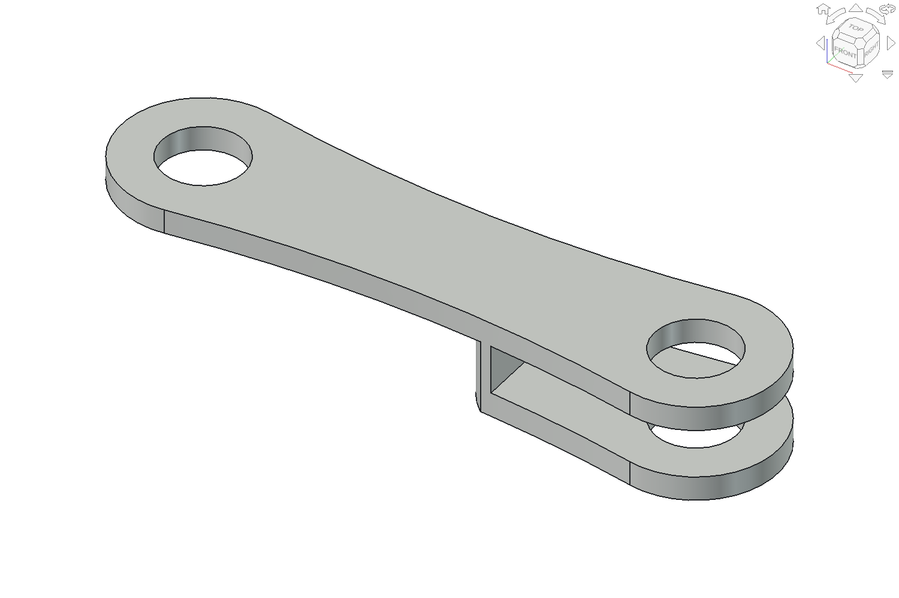
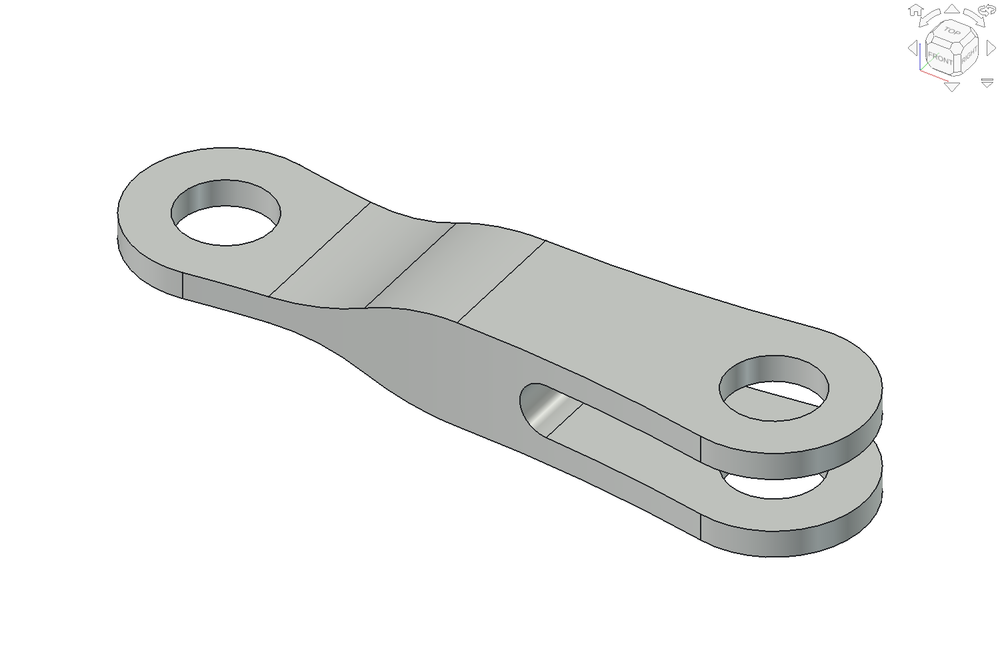
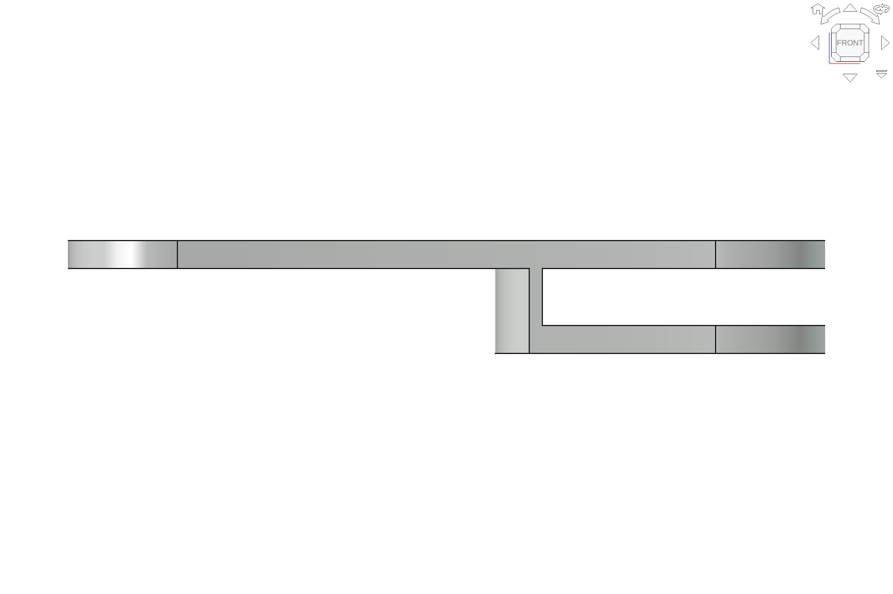
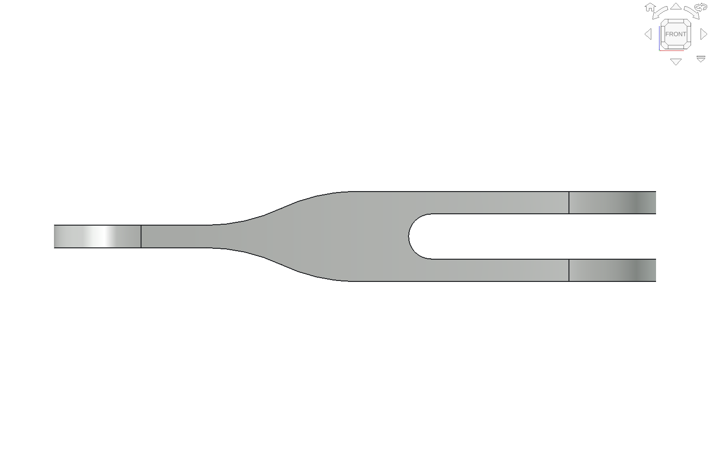

# R15b: symmetric-depth A–B rocker

The user's depth-symmetry correction supersedes the earlier decision to retain the r14 rocker unchanged in r15. R15b preserves the saved r15 checkpoint and changes the rocker section and its A-pivot axial stack in a separate native assembly.

## Source interpretation

Movie S1 at 54–58 seconds, especially the exposed bars at 55 seconds and transverse hardware installation at 58 seconds, supports a continuous single-eye A end flowing into a fork only at B. The supplied close-up and explicit user correction call for a web centred between the two B cheeks, rather than the earlier full-length leaf with a cheek added to one side. These views constrain morphology; they do not report exact depth, wall thickness, slot radius, or supplier fits.

Source stills: [55 seconds](../references/visual/r11_movie_s1/s1_55s.png), [58 seconds](../references/visual/r11_movie_s1/s1_58s.png), and [extraction provenance](../references/visual/r11_movie_s1/provenance.json). Original research: Wang et al., *Unlocking fast robotic locomotor propulsion through dynamic spine-leg synergy*, DOI [10.1126/sciadv.aed5603](https://doi.org/10.1126/sciadv.aed5603). This is an independent source-informed reconstruction.

## Actual native geometry

| Before: r15 retained offset web | R15b: centred, balanced depth |
| --- | --- |
|  |  |
|  |  |

The screenshots show actual FreeCAD BReps under matched cameras. The new shape uses a native organic-outline Pad, a Pocket with mirrored tangent-arc side reliefs, a rounded B-only slot Pocket, and a through-bore Pocket. All four sketches on each rocker are fully constrained. The single A eye and web remain 1.2 mm thick; matching S-shaped depth transitions widen the section towards the fork. The B slot has a semicircular root, with at least the previous 8 mm open zone measured inward from the B axis.

| Quantity | Branch 1 | Branch 2 | Evidence |
| --- | --- | --- | --- |
| A–B centre distance | 24.1215 mm | 24.1215 mm | Retained paper-reported mechanism parameter |
| B cheek centres, absolute robot Y | 32.4 / 36.0 mm | 30.6 / 36.0 mm | Retained provisional assembly stack |
| New web/A-eye centre, absolute robot Y | 34.2 mm | 33.3 mm | Derived midpoint of retained B cheeks |
| Total fork depth | 4.8 mm | 6.6 mm | Derived from centres and assumed 1.2 mm cheeks |
| Clear axial fork gap | 2.4 mm | 4.2 mm | Derived nominal gap; fit not qualified |
| A inner-race spacer length | 5.4 mm | 4.5 mm | Derived from retained 28.2 mm inner stop |
| A outer-race spacer length | 3.2 mm | 4.1 mm | Derived from retained 38.0 mm outer stop |
| Rounded slot-root radius | 1.2 mm | 2.1 mm | Assumed semicircular root matching gap |
| Full-depth bridge before slot root | 2.8 mm | 1.9 mm | Derived; strength not qualified |

The 8 mm outline, 6 mm sagittal waist, 1.2 mm web/cheeks, 4.05 mm bores, and depth-ramp dimensions remain `DESIGN_ASSUMPTION`. The ramp starts 20 mm inward from B and reaches full depth 12 mm inward from B. [Authoritative r15b configuration](../parameters/assembly_r15b.json).

Four handed rocker sources and four A-spacer sources change. Four A-eye bearings and eight spacer instances are repacked; eight of those twelve hardware links have a changed placement matrix, while four retain an endpoint and change only through source length. The inventory remains **455 physical instances and 108 source definitions**. All 100 unaffected source BReps pass the strict identity comparison, including the complete r15 lumbar frame.

The B cheek layers, B-joint bearings/spacers/shafts, A fixed frame seats, A outer bearings, sagittal A/B axes, motor envelopes, leg attachment geometry, and kinematic parameters remain unchanged. The A–B source-local placements and physical-instance placement matrices are unchanged. Each handed source has an explicit local-Z symmetry plane offset within that preserved frame; source +Z maps to robot −Y on both sides. No negative instance scale or mirrored instance transform is introduced.

## Executed checks and evidence

The lead constructed and inspected the new native geometry through the installed FreeCAD MCP, following a box/cylinder sanity round trip in an initially empty application session. Isolated installed FreeCADCmd processes supplemented the live session with read-only checks on saved files and a separate unsaved edit-probe copy.

| Gate | Result and evidence |
| --- | --- |
| Identity and symmetry | PASS; all four rockers have zero measured bidirectional BRep difference after reflection about their depth midplanes; [identity report](../reports/verification/r15b_identity.json) |
| Native reopen/recompute | PASS; 108 sources, 455 instances, 325 fully constrained sketches; forced recompute preserves geometry; [native report](../reports/verification/r15b_native.json) |
| Native feature edits | PASS; through-bore sketch moved 0.025 mm and spacer Pad length increased 0.025 mm in a disposable copy; both changes affected geometry and restored strictly |
| Current section factory | PASS; all four rocker sections rebuilt independently and matched strictly to saved native sources; [factory evidence](../reports/verification/r15b_factory_rebuild.json) |
| STEP round trip | PASS; all 455 placed solids matched one-to-one with the strict adaptive-volume/bounds gate; [STEP report](../reports/verification/r15b_step.json) |
| Animation AX0/AX1 | PASS; neutral and two non-neutral poses, 455 stable IDs, six commanded coordinates and separate prescribed knee states; [AX report](../reports/animation/ax01_r15b.json) |
| Numerical spine closure | 361 integer-degree samples; [motion report](../reports/verification/r15b_motion.json) |
| Changed-pair clearance | 91 cycle phases at 4° and nine existing coordinated-profile poses; all 7,144 pairs per pose involving any of the 16 revised/repacked instances; [motion report](../reports/verification/r15b_motion.json) |
| Inventory | PASS; 455 stable instance IDs, 108 source-definition rows; [BOM evidence](../reports/verification/r15b_bom.json) |

The source-to-world convention is verified by the existing read-only adapter. The largest AX0/AX1 local-to-world vertex reprojection error is below 1e-12 mm. Changed fixed A hardware uses its saved physical placement; it is deliberately absent from the sparse historical MotionMap and included in the explicit grounding audit. The MotionMap itself is unchanged. Springs and cables retain their original anchor/routing regeneration; no new loaded-motion inference is made.

The finite screen checks pairs involving changed instances, with conservative transformed-source bounding boxes before exact OCC intersection checks. Unchanged rigid relative poses reuse their exact pair result. It has no blanket contact exemption. Previous r15 evidence remains the reference for pairs not affected by this change. The configuration, native file, solver, generator sources and captured results are recorded in the revision package.

## Files and reproduction

- Native: [flexor_r15b_robot.FCStd](../cad/flexor_r15b_robot.FCStd).
- STEP: [flexor_r15b_robot.step](../exports/step/r15b/flexor_r15b_robot.step).
- Read-only pose handoff: [ax01_r15b.json](../animation/motion/ax01_r15b.json).
- [Instance inventory](../bom/instances_r15b.csv) and [source quantities](../bom/bom_r15b.csv).
- [Assembly screenshot](../reports/views/r15b_robot_isometric.png), [spine close view](../reports/views/r15b_spine_close.png), and [capture manifest](../reports/views/r15b_capture_manifest.json).
- [Source review](../reports/reviews/r15b_symmetric_rocker_source.md) and [independent code/mechanical review](../reports/reviews/r15b_symmetric_rocker_independent.md).
- [Hash-bound checkpoint summary](../reports/verification/r15b_checkpoint_summary.json).

`src/symmetric_rocker_r15b.py:integrate(doc)` runs on a disposable copy of the preserved r15 native checkpoint through the lead's installed MCP session. It refuses to overwrite an existing r15b checkpoint. It is a revision migration; a full rebuild through the historical source chain remains unqualified. The canonical saved file is the reviewable result.

Supplementary checks, each against separately opened files:

```bash
R15B_CHECK_MODE=native /snap/bin/freecad.cmd src/run_checks_r15b.py
R15B_CHECK_MODE=ax /snap/bin/freecad.cmd src/run_checks_r15b.py
R15B_CHECK_MODE=motion /snap/bin/freecad.cmd src/run_checks_r15b.py
R15B_CHECK_MODE=step /snap/bin/freecad.cmd src/run_checks_r15b.py
python src/bom_symmetric_r15b.py
```

## Limits retained

This is a mechanically checked research CAD checkpoint. Finite poses do not certify continuous, all-gait or loaded clearance. Section strength/fatigue, SLS process allowance, bearing fits, inner/outer-race thrust and capture, shaft/clip supplier details, access/insertion and passive spring/cable response remain unqualified. The nominal spacer/frame overlap in axial projection at 28.2–28.4 mm is screened against the actual bored frame BRep; zero intersection does not qualify the race seating or thrust load path. Branch 2's 1.9 mm bridge needs structural review. No drawings or fabrication release are produced.

The existing r15 and r14 videos retain their original geometry. No r15b Blender video is claimed; a future animation rebuild must consume this new CAD and motion manifest.
