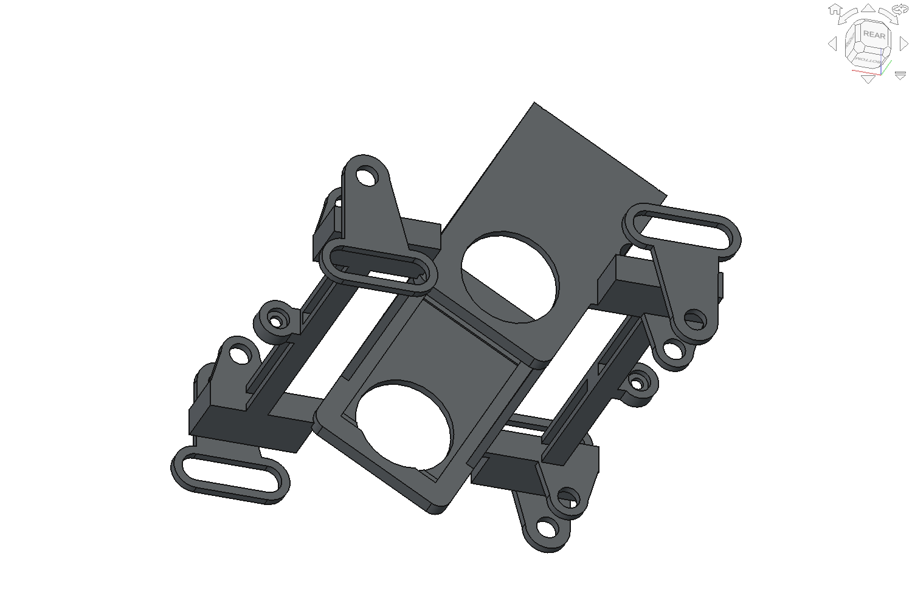
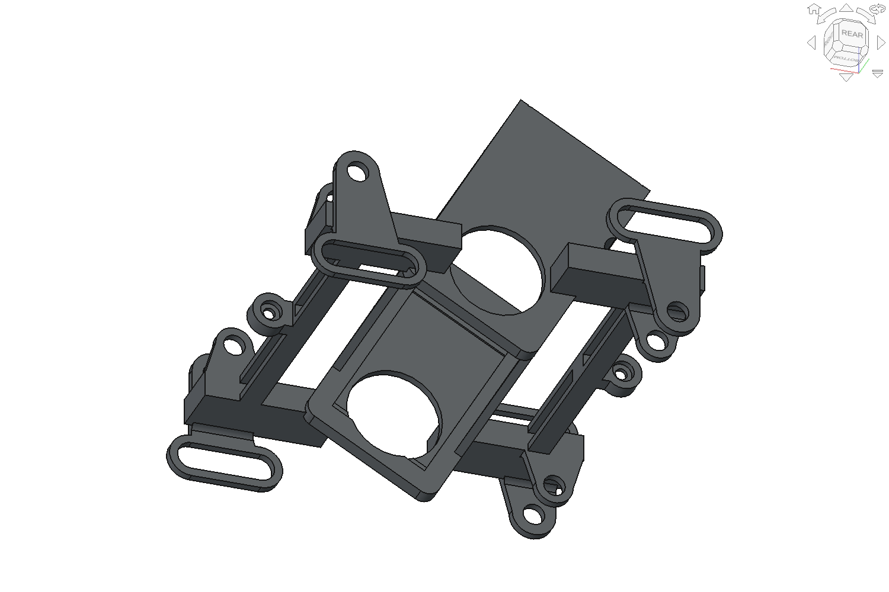
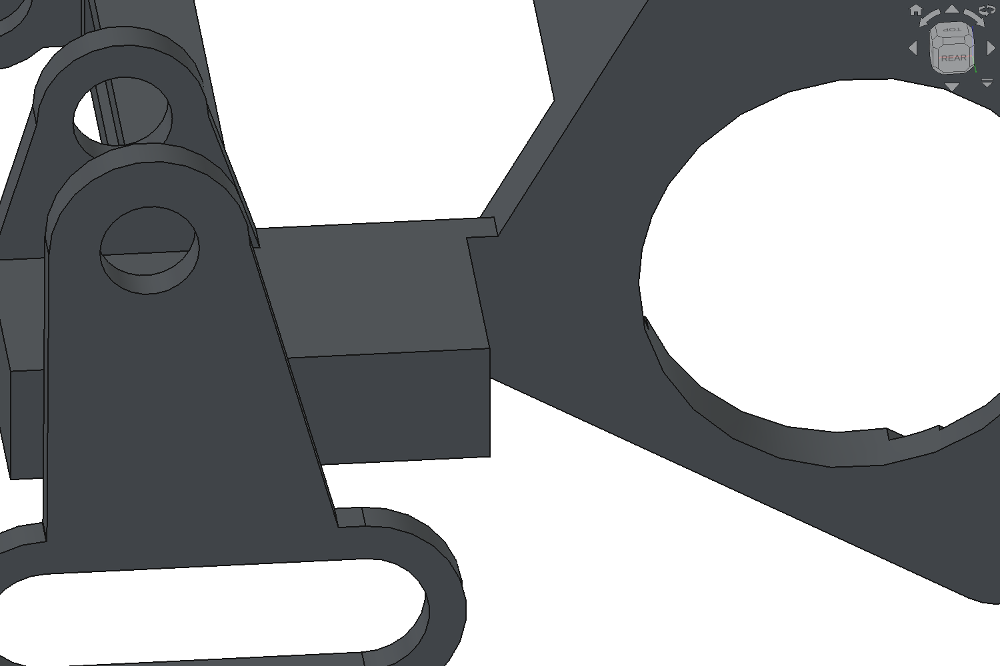
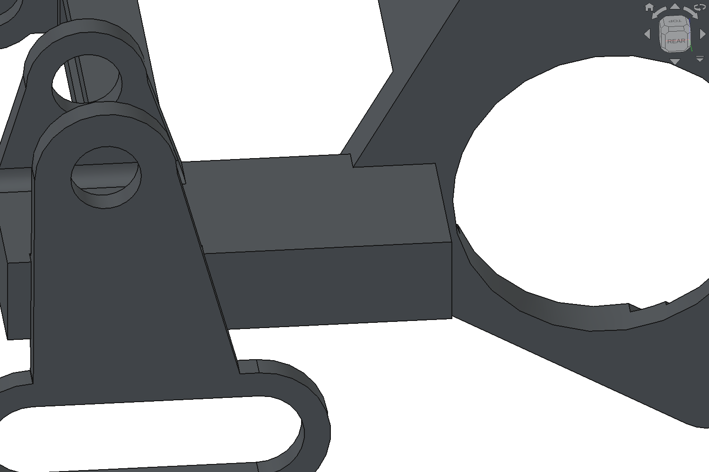
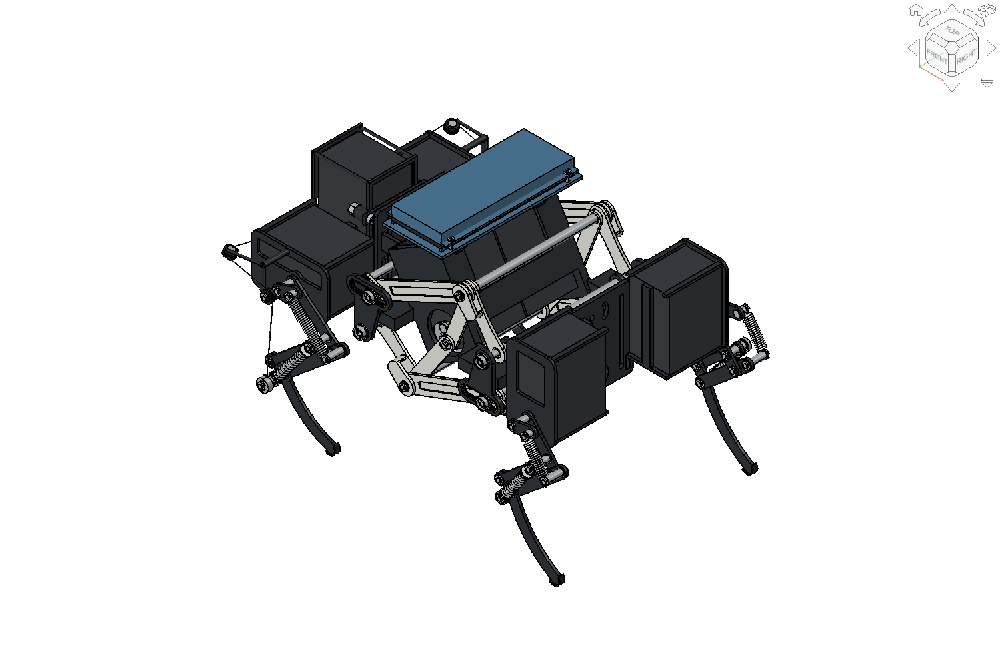
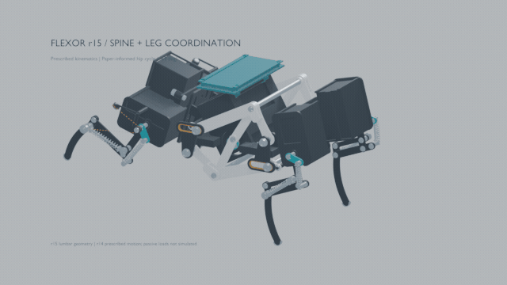

# r15 geometry comparison

**Snapshot:** 2026-10-16. Final native, identity, STEP exchange, AX0/AX1, numerical-cycle, and bounded finite-motion reports pass for their stated scopes. The short Blender preview passed saved-scene, articulation, units/reprojection and MP4/GIF QA. This is a geometry comparison, not a fabrication release.

## Matched views

The eight-view capture manifest records matching camera and scale for each r14/r15 pair. These are actual saved native geometry views. The underside pair exposes the new shelf-to-motor-shoulder pads; the close view shows their extent beside the retained motor/horn opening. The whole-robot views below are read-only captures from an isolated offscreen FreeCAD GUI; neither native file was saved.

| r14 baseline | r15 candidate |
|---|---|
|  |  |
|  |  |
|  |  |

Full matched lumbar views: [r14](../views/r14_lumbar_matched.png) · [r15](../views/r15_lumbar_matched.png). Matched root views: [r14](../views/r14_root_matched_close.png) · [r15](../views/r15_root_matched_close.png). The root close-up is partly occluded by the guide; the matched underside pair supplements it by exposing the repeated shoulder bridges and retained root transitions.

## Changed geometry and measured comparison

| Item | r14 | r15 | Evidence and limits |
|---|---:|---:|---|
| Lumbar root blends | Square/straight root transitions | Twelve native concave R1 mm fillets: four short-ear/A-bearing roots and eight guide roots | `RootBlendShortEarR15` and `RootBlendGuidesR15`; 27.4591 mm³ added, zero removed. R1 mm is an assumed radius, not a source measurement. |
| Shelf-to-motor shoulders | Thin inner platform connection at the motor cheek | Four native 6×5×9.4 mm additive pads | Source X ranges [10,16] and [−16,−10] mm; Y=±2.5 mm; near Z=−9.4–0 mm; far Z=56.8–66.2 mm. 1,128 mm³ added, zero removed. Extents are design assumptions based on qualitative source comparison. |
| Final lumbar frame volume | 15,444.9956 mm³ | 16,600.4547 mm³ | +1,155.4591 mm³ overall; bounding box unchanged. At assumed 1,000 kg/m³, +1.1555 g for this frame alone. |
| Instance/source identity | 455 instances / 108 sources | 455 instances / 108 sources | `r15_identity.json`: only `FRM_LUMBAR_COMPACT_CAGE_r12` and `LumbarIntegrated1` changed; no IDs added/retired; 107 sources strictly unchanged; all link placements and MotionMap/pose parameters equal. |

The selected support ears carry the A1/A2 support bores; they are not the separate central-E bearings. The central-E bearing datum remains source-local X=±33 mm, Y=0, Z=28.4 mm. The r15 candidate retains the 78.8 mm frame span, 28 mm housing, accepted A–B rocker, blind B–C recess with its 0.6 mm floor, guide slots, and other mechanism datums.

The short Blender interoperability preview is [the GIF](../../animation/previews/r15_spine_leg_coordination.gif) ([MP4](../../animation/previews/r15_spine_leg_coordination.mp4)). Its scene contains 455 instances and 108 sources; the changed lumbar mesh has 6,251 vertices and 12,598 triangles. Four sampled poses show both legs and the fore-leg extension spring changing. The 60-frame, 5-second, 640×360 outputs pass the checks recorded in [preview QA](../animation/r15_preview_qa.json). The full r14 videos remain unchanged.

## Section screen and independent review

The root-section report covers 108 sampled regions and records a minimum area/principal-moment ratio of 0.9999999999994; all four A1/A2 bore-support windows remain unchanged within the strict comparison tolerance. Those root sections were taken on the root-only prototype before shoulder pads were added. Their ROIs at |X|=22–37 mm do not overlap the shoulder pads at |X|=10–16 mm, and the shoulder operation retained the root geometry. The separate shoulder screen covers 12 actual source-X-normal YZ sections at X=±10.5, 13, and 15.5 mm. Each grows from 8 to 55 mm², an area ratio of 6.875. The reported 33.275 minimum sorted principal-moment ratio compares ranked eigenvalues after the principal directions switch. For these rectangular sections, the fixed-axis second-moment ratios are approximately 324.951 about source Y and 6.875 about source Z. These are local geometric section comparisons; they do not quantify assembled stiffness under load or establish strength, buckling capacity, or fatigue life.

The independent review accepted the additive roots and shoulder pads for the controlled candidate. It found no P0/P1 issue in the bounded static evidence and clarified the fixed-axis interpretation above. The source supports a tapered support silhouette and a continuous shelf; no exact R1 radius or shoulder depth is recovered from the images. The dimensions and material-density estimate remain assumptions.

Evidence is recorded in [`r15_integration.json`](../verification/r15_integration.json), [`r15_identity.json`](../verification/r15_identity.json), [`r15_prototype_integrated_roots.json`](../verification/r15_prototype_integrated_roots.json), [`r15_prototype_sections.json`](../verification/r15_prototype_sections.json), [`r15_shoulder_prototype.json`](../verification/r15_shoulder_prototype.json), [`r15_shoulder_sections.json`](../verification/r15_shoulder_sections.json), and [`r15_prototype_independent_review.md`](r15_prototype_independent_review.md). The capture hashes are in [`r15_prototype_capture_manifest.json`](../views/r15_prototype_capture_manifest.json); input and report hashes are in [`r15_prototype_evidence_binding.json`](../verification/r15_prototype_evidence_binding.json).

## Final verification snapshot and limits

The current reports pass their defined checks. Earlier failure and diagnostic artifacts remain chronological attempts and do not supersede these final results.

- `r15_native_checks.json`: PASS; reopened/recomputed all 455 instances and compared 108 sources, with 325 fully constrained sketches and three disposable-copy edit/restore probes.
- `r15_assembly_export.json`: PASS; 455 placed solids round-trip one-to-one under strict geometry checks. The exporter used detached copies of native placed BReps in the temporary exchange document.
- `ax01_r15.json`: AX0 and AX1 PASS for the final native SHA, with 455 instances/108 sources and 409 native motion entries plus 46 explicitly grounded instances give complete 455-instance coverage.
- `r15_numeric_cycle.json`: PASS over 361 one-degree samples; endpoint joint error 1.776e-15 mm and maximum all-instance transform-matrix difference 1.776e-15, maximum adjacent output-angle step 0.00972447 rad.
- `r15_motion.json`: `PASS_BOUNDED_ADDITIVE_DELTA_R15`; 91 four-degree samples, 16 actual added solids against 454 other instances, 661,024 pair decisions and 1,732 exact OCC checks, with no positive-delta intersections or guide warnings. Nine prescribed poses of the complete changed frame add 1,429 exact OCC checks, all passing. Old-frame evidence is reused only with exact native/configuration/profile binding. This is finite-sample evidence, not continuous-clearance certification.
- `r15_identity.json`: PASS; 455 instances/108 sources, one changed source/instance, 107 unchanged sources, with placements and MotionMap retained.

These geometric and kinematic gates do not establish continuous clearance, loaded equilibrium, strength, buckling, fatigue, supplier fit, process capability, or fabrication readiness. No fabrication release is implied. The preview's saved-scene, unit/reprojection, full MP4 decode, GIF timing, articulation, and sampled image checks passed in `reports/animation/r15_preview_qa.json`.
